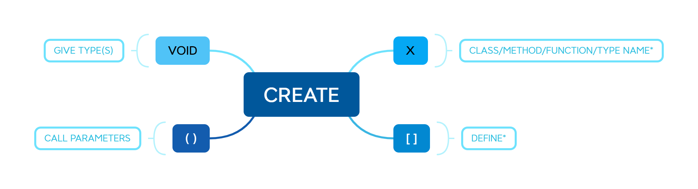
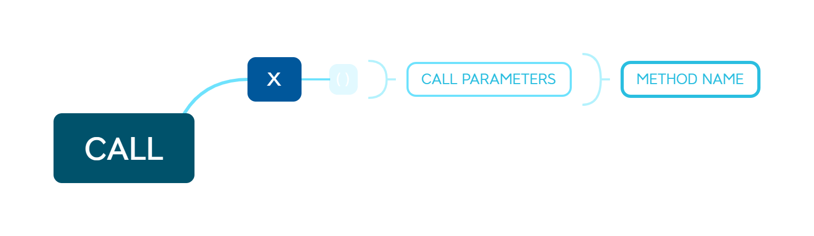
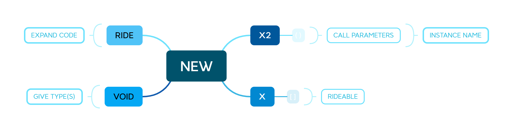

# Do We Need Another "X" Language?

**eXtensible (X++)** is an **ORIGIN** native-style user-friendly general-purpose programming language designed for cross-platform development. It focuses on ease of use, readability, and extensibility via libraries, combining markup language simplicity with native programming functionality. This makes it ideal for anything from simple task managers to game engines. X++ uses native code for compilation and supports object-oriented, functional, and dynamic features.

---

### Extensible Programming Language (XPL)

XPL is an easy-to-learn compiled language, turning code into binary applications. It’s a versatile general-purpose language, leveraging native code to simplify API calls and create interfaces with minimal complexity. The goal is to build a truly cross-platform language, from simple utilities to advanced applications like game engines.

### Key Characteristics
- **High-Level Scripting Language**: XPL is primarily designed for readability and simplicity, not compilation speed.
- **Future Plans**: Implementation of **real-time** compiler, garbage collection, and memory management systems are on the horizon.

### Features Inspired by Other Languages
   **COMPILED** – Fast binaries, quick execution [Inspired by C++]
   
   **EXTENSIBLE** – Expand functionality via libraries [Inspired by C++ Libraries]
   
   **EASY TO USE** – Clear, readable syntax [Inspired by Python, C#]
   
   **CROSS PLATFORM** – Runs on any platform [Inspired by JavaScript]
   
   **OBJECT-ORIENTED** – OOP principles [Inspired by Objective-C]
   
   **FUNCTIONAL** – Includes functional programming features
   
   **STRICT** – Enforces strict syntax and conventions
   
   **LINE** - Line-by-Line Execution [Python]
   
   **STRICT** - Strict Syntax
   
   **CHAINED** - Chained Syntax [Swift]
   
   **MODEL** - Model-Based Programming [Swift]
   
   **PROCEDURAL INFERENCE**  - Dynamic Type you don't have to declare types, yet strongly recommended [Python], Static Type, must declare types [C++] or be Warned [C#] Disable in Compiler Options

### Define a Variable <TYPE>

A variable should be defined with a type.
Generally, you can define and set a variable by using the following syntax:

    <TYPE> <NAME>: <VALUE>

**TYPE** is the type of variable you are defining. **NAME** is the name of the variable. *VALUE* is what you want the variable to be set to.

This can be any of the following:

    STRING Welcome: "Hello World!"  
   Define a String variable.
    
    INDEX Greetings: ["Hello", "Hey!", "Hi!"]  
   Array/Dictionary/LIST type. Can be used as an index.
   
    FLOAT Float: 12.0  
   Extended Float High Precision - Memory intensive.
   
    INTEGER Int: 0  
   Define and assign an integer.
   
    BOOL Check: TRUE/FALSE/EXIST  
   Boolean check with safe check.
   
    OBJECT Obj: { "Key": "Value" }  
   JSON Object-like indexing system.

Required: Types should be ALL-Caps and should be defined before the variable name. The variable should be defined in Cap-Case: Meaning the first letter capitalized and the rest lowercase, while spaces should NOT be used when defining variable names.

*Example: This_Is_A_Variable*

The VALUE of the variable should be assigned as needed.

### CREATE A Function

Function names can start with a capital letter or use all caps. Declare the return type before `CREATE` and put the parameters in parentheses after the function name. Use `VOID` for a function that returns no value.

    VOID CREATE X()[
        DISPLAY[Greeting]
    ]

Use `GIVE` to return a value. The return type can differ from the parameter type. For example, `ToInteger("42")` takes a `STRING` and returns the `INTEGER` `42`.

    INTEGER CREATE ToInteger(STRING Text)[
        GIVE INTEGER(Text)
    ]

To return multiple values from a single call, separate the return types with spaces before `CREATE`. Use `GIVE` with comma-separated values in the same order. The caller receives the values in an `INDEX`. In this example, `Convert(42, "7", 3)` returns `["42", 7, 3.0]`.

    STRING INTEGER FLOAT CREATE Convert(INTEGER Number, STRING Text, INTEGER Count)[
        GIVE STRING(Number), INTEGER(Text), FLOAT(Count)
    ]

The current Kit parser still expects commas between declared return types. The space-separated signature above is the X syntax.

### Class Scope and Field Visibility

Declare a class with `CREATE Name[ ... ]`. The class body defines its fields and methods, and the class name can serve as a type in declarations such as `Player Target: NULL`.

| Class field declaration | Kit Inspector |
| --- | --- |
| `INTEGER Score: 0` | Private by default and hidden from the Inspector. |
| `PUBLIC INTEGER Health: 100` | Visible and read-only in the Inspector. |
| `EDIT FLOAT Speed: 3.0` | Visible and editable in the Inspector. |

`PUBLIC` and `EDIT` go before a class field's type. `EDIT` supports `STRING`, `INTEGER`, `FLOAT`, `BOOL`, and `VECTOR`.

    CREATE Player[
        INTEGER Score: 0
        PUBLIC INTEGER Health: 100
        EDIT FLOAT Speed: 3.0

        VOID CREATE AddPoint()[
            Score: Score + 1
        ]
    ]

### Call A Function

CALL: EXECUTE/USE/GET/SET
    
    CALL X()

### CREATE an Instance of a... Class

NEW: To implement a NEW instance of a class, you must use the NEW keyword.  In this example, NEW will create a new instance of the "X" class and name it "X2". 

    NEW X2 X()

### RIDE and CREATE an Instance of... Class with Parameters

 You can also use the RIDE keyword to create a new instance of a class that implements the RIDEABLE interface.  This will allow you to create a new instance of a class that implements the RIDEABLE interface for overwriting classes a type of INHERITANCE/POLYMORPHISM paradigm.

*Convention: Parameters All-Lower case.*

    RIDE NEW X2 X(STRING string, INTEGER int)[
        DISPLAY[string]
        DISPLAY[int] #Convention: Pass variable ARGUMENTS
    ]

### GRAB to ITERARATE through an INDEX
 
    GRAB Greeting IN Greetings[
        DISPLAY[Greeting]
    ]

    #Display "Hello!"
    #Display "Hey"
    #Display "Hi"
